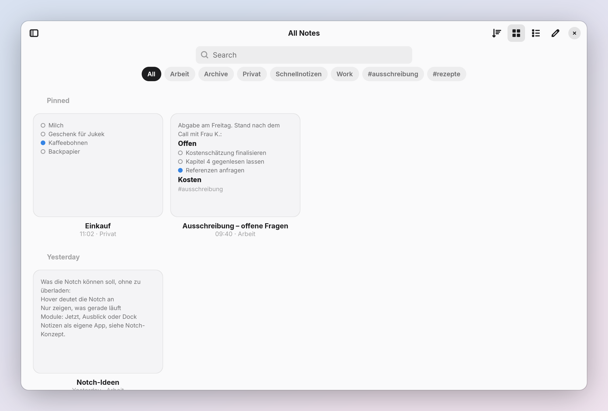
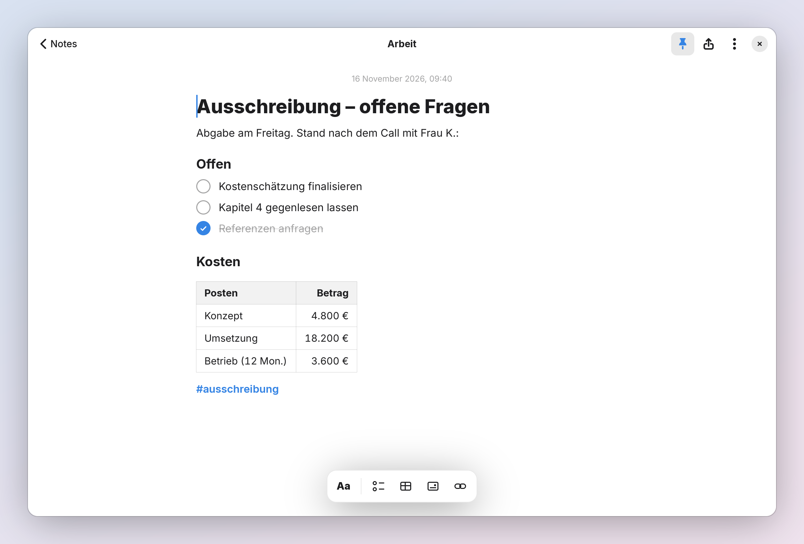

# Sheaf

Fast, native notes for GNOME – Apple Notes–style, plain Markdown files.

Sheaf is a notes app for the GNOME desktop, written in Rust with
[GPUI](https://www.gpui.rs). It shows your notes as a gallery of cards, edits them in
place and finds them in milliseconds. Every note is an ordinary Markdown file in a folder
you choose. In GNOME it is called "Notes" ("Notizen" in German).

<picture>
  <source media="(prefers-color-scheme: dark)" srcset="docs/screenshots/app-gallery-dark.png">
  
</picture>

<picture>
  <source media="(prefers-color-scheme: dark)" srcset="docs/screenshots/app-note-dark.png">
  
</picture>

Sheaf is not released yet. Version 0.1.0 is being prepared: see
[docs/release-checklist.md](docs/release-checklist.md) and
[docs/STATUS.md](docs/STATUS.md).

## Features

- Gallery of cards with a miniature of each note, grouped by date, and a list view.
  Folders, tags, pinned notes, smart folders and templates.
- Editing in place: checklists, tables, images, links between notes, a format bar and a
  slash menu. Notes save a moment after the last change and when you leave them.
- Search that forgives typos, knows German umlauts and understands `#tag`, `folder:`,
  `has:`, `open:`, `modified:` and `pinned:`. It answers in milliseconds, also with
  10,000 notes.
- Quick Note window with a global shortcut (Ctrl+Shift+N).
- Notes in the GNOME overview, through a search provider.
- Recently Deleted, attachments, backlinks, export to Markdown and PDF, printing.
- A command line for scripts and AI agents, with JSON output.
- English, German, Spanish, French, Brazilian Portuguese, Italian, Polish, Russian, Simplified Chinese and Japanese (the translations other than German are machine-assisted and not yet reviewed by native speakers).

## Install

### Flatpak

Sheaf is not on Flathub yet. When it is:

```sh
flatpak install flathub io.github.taulit.Sheaf
```

The Flatpak can read your Documents folder. For another notes folder, give it access:

```sh
flatpak override --user --filesystem=~/Sync/Notes io.github.taulit.Sheaf
```

### Arch Linux (AUR)

```sh
yay -S sheaf        # the release
yay -S sheaf-git    # the development version
```

The packages are not in the AUR yet. Their files are in [build-aux/aur](build-aux/aur).

### From source

```sh
git clone https://github.com/taulit/sheaf && cd sheaf
cargo build --release --locked
sudo build-aux/install.sh /usr/local
```

[build-aux/install.sh](build-aux/install.sh) installs the binaries, the desktop file, the
icons, the metainfo, the D-Bus service files, the search provider, the translations and
shell completions. Use `/usr` or `/usr/local`: GNOME Shell reads search providers only from
the system data directories, so a prefix under your home folder gives no search in the
overview.

## Search in the GNOME overview

Sheaf adds a search provider, so typing in the overview finds notes under "Notes". The
provider starts on demand and uses about 11 MB while it runs.

Flatpak turns exported search providers off. Switch Sheaf on once: Settings, Search, then
the switch next to Notes. Installs without Flatpak need nothing.

## Command line

`sheaf` with a command works without a window. `--json` gives one JSON document with a
stable schema.

```sh
sheaf new "Milk"                                  # create a note, prints its id
sheaf search 'milk #shopping has:checklist' --json
sheaf list --folder Work --modified-since 2026-11-01
sheaf tasks --open                                # open checklist items of all notes
sheaf append "Milk" "- [ ] oat drink"
```

`sheaf help` lists every command. [docs/AGENTS.md](docs/AGENTS.md) tells AI agents how to
read and write notes, and [skills/sheaf-notes](skills/sheaf-notes/SKILL.md) is a skill folder
to copy. The JSON schemas are in [docs/cli-schema](docs/cli-schema/README.md).

## Visor module

[Visor](https://github.com/taulit/visor) puts a notch in the middle of the GNOME top bar.
"Visor: Notes" in [visor-module/](visor-module/) adds the latest notes, search and quick
notes to it. Build the extension zip and install it:

```sh
scripts/pack-visor-module.sh
gnome-extensions install --force target/sheaf-visor@taulit.github.io.shell-extension.zip
gnome-extensions enable sheaf-visor@taulit.github.io
```

It needs Visor and Sheaf. Log out and in once after the first install.

## Notes folder

- One `.md` file per note. Subfolders are the folders of the app. The first line is the
  title and the file name follows it.
- Tags are `#words` in the text. Frontmatter is written only when needed (`id`, `created`,
  `pinned`) and a file Sheaf did not change stays byte for byte the same.
- Attachments are in `_attachments/` next to the notes and linked with relative paths, so
  other editors show them.
- `.trash/` holds deleted notes and `.sheaf/` the settings and templates of the folder. The
  search index lives in `$XDG_CACHE_HOME/sheaf` and can be deleted.
- The default folder is `~/Documents/Notes` (`~/Documents/Notizen` in German). Change it in
  Settings, with `SHEAF_NOTES_DIR` or with `--dir`.
- Sync it with the tool you already use. Changes from outside show up while the app runs.

Details: [docs/ARCHITECTURE.md](docs/ARCHITECTURE.md).

## Keyboard shortcuts

Ctrl+? shows the list in the app.

| Keys | Action |
|---|---|
| Ctrl+N | New note |
| Ctrl+F, or just type | Search |
| Ctrl+K | Command palette |
| Esc, Ctrl+W | Back to the gallery |
| Ctrl+P | Pin or unpin |
| Ctrl+Shift+N | Quick Note |
| Ctrl+, | Settings |
| Ctrl+? | Keyboard shortcuts |
| Ctrl+Q | Quit |

In a note the editor's keys apply (Ctrl+B, Ctrl+I, Ctrl+F find, Ctrl+. fold, `/` for the block
menu, `/template` for a template), with the link prompt on Ctrl+Shift+K since Ctrl+K is the
palette.

## Build

```sh
cargo build --workspace
cargo test --workspace
cargo run -p sheaf            # the app; `cargo run -p sheaf -- help` for the commands
scripts/screenshot.sh         # renders docs/screenshots/app-*.png offscreen
```

Requires:

- Rust 1.95 or newer.
- Access to [gpui-markdown-editor](https://github.com/taulit/gpui-markdown-editor), the
  editor component, a private repository for now. Cargo fetches it over https with your
  git credentials; `CARGO_NET_GIT_FETCH_WITH_CLI=true` lets it use the git command line and
  its ssh setup.
- The libraries GPUI builds against.
  Debian and Ubuntu: `pkg-config libfontconfig-dev libfreetype-dev libwayland-dev
  libxkbcommon-dev libxkbcommon-x11-dev libx11-xcb-dev libxcb1-dev libvulkan-dev`.
  Arch: `pkgconf fontconfig freetype2 wayland libxkbcommon libxkbcommon-x11 libxcb
  vulkan-icd-loader`.
  Running the app needs a Vulkan driver (Mesa has one for every common GPU).
- For the tests, `dbus-daemon` and `gettext`; for the screenshots, a GPU or Mesa's software
  Vulkan driver (lavapipe).

[docs/testing.md](docs/testing.md) describes the checks that run Sheaf inside a headless
GNOME Shell. [docs/packaging.md](docs/packaging.md) covers Flatpak, AUR and the release.

## Contributing

Issues and pull requests are welcome at <https://github.com/taulit/sheaf>.

- Commit messages follow [Conventional Commits](https://www.conventionalcommits.org/).
- Before a pull request: `cargo fmt --check`, `cargo clippy --workspace --all-targets
  --all-features`, `cargo test --workspace --all-features` and `cargo deny check`.
- Every visible string goes through gettext. `scripts/update-pot.sh` refreshes `po/`;
  [po/de.po](po/de.po) is the German translation. A new language is a new `.po` file and a
  line in [po/LINGUAS](po/LINGUAS).
- The plan and the decisions behind the code are in [docs/design/plan](docs/design/plan/README.md)
  and [docs/ARCHITECTURE.md](docs/ARCHITECTURE.md).

## Related projects

- [taulit/visor](https://github.com/taulit/visor): a notch for GNOME Shell. "Visor: Notes"
  connects it to Sheaf.
- [taulit/gpui-markdown-editor](https://github.com/taulit/gpui-markdown-editor): the
  Markdown editor component of Sheaf, for any GPUI app (Sheaf uses `v0.1.0`).

## License

GPL-3.0-or-later. See [LICENSE](LICENSE). The app icon is released under CC0-1.0
([data/icons](data/icons/README.md)).
